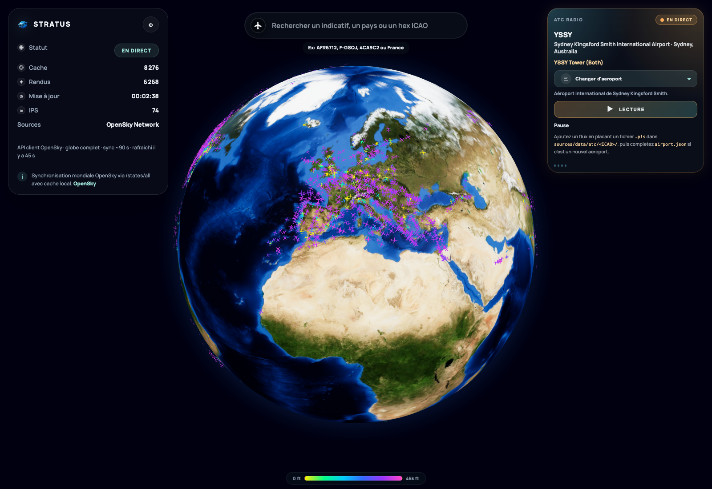
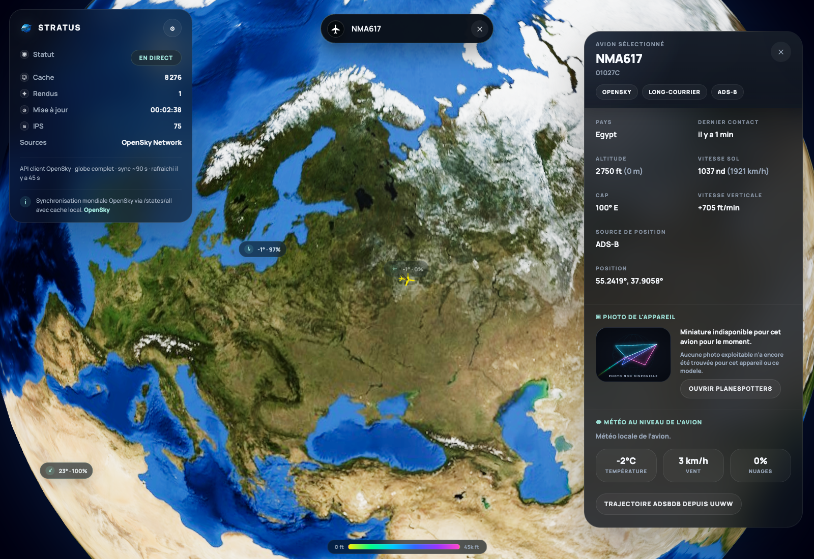
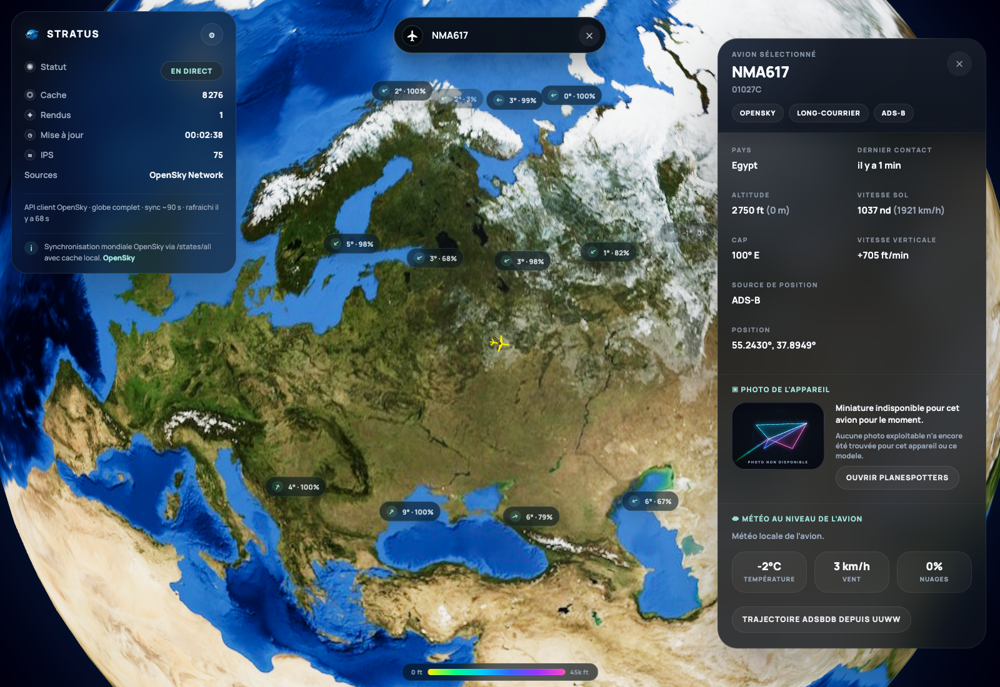
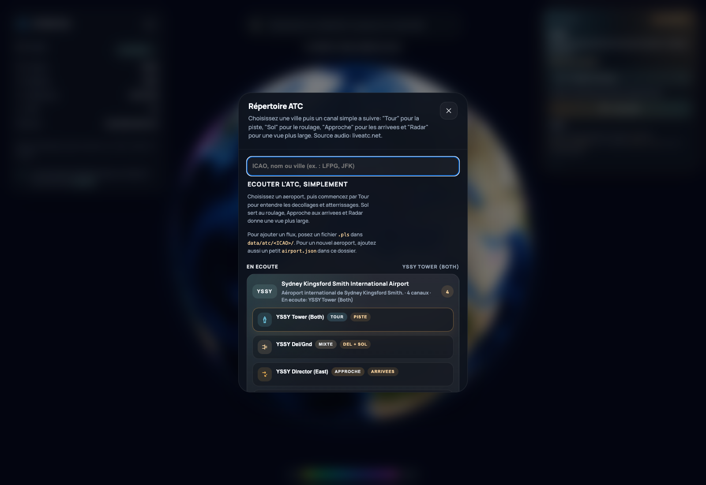
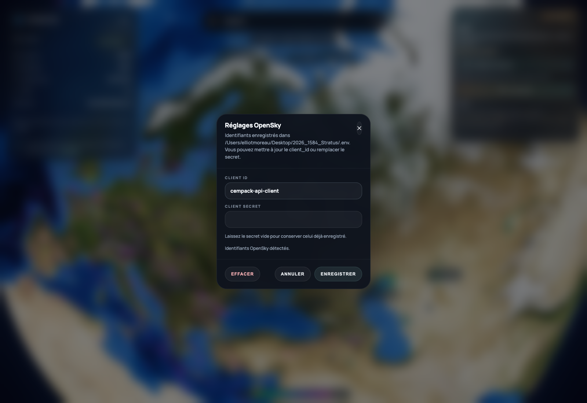

<div align="center">

<h1> Stratus</h1>
<p><strong>Suivi aérien en temps réel sur globe 3D</strong></p>
<p>OpenSky · Flask · JavaScript</p>
</div>

---

##  Aperçu

Stratus affiche les avions sur un globe 3D et ajoute autour de cette vue :

-  une recherche radar,
-  une fiche avion détaillée,
-  une couche météo,
-  un répertoire radio ATC,
-  des réglages OpenSky.

---

##  Lancement

### En local (développement)

Depuis la racine :

```bash
python3 -m venv .venv
source .venv/bin/activate
pip install -r requirements.txt
python -m stratus
```

Le serveur écoute sur `http://localhost:8090` (variable `PORT`). Il sert l'API (`/api/...`) et, si elle est construite,
l'interface `web/dist` ; sinon une page d'attente s'affiche. Pour construire l'interface :

```bash
cd web && npm ci && npm run build
```

Les tests du backend (hors ligne, aucun appel réseau) : `pip install -r requirements-dev.txt && python -m pytest -q`.

### En production (gunicorn)

Un seul worker, car les flux de données tournent dans le processus ; les threads servent les requêtes en parallèle :

```bash
gunicorn -w 1 --threads 16 -b 0.0.0.0:8090 --timeout 60 'stratus.api:create_app()'
```

### Avec Docker

```bash
docker build -t stratus .
docker run -p 8090:8090 -v stratus-cache:/app/data/cache \
  -e OPENSKY_CLIENT_ID=... -e OPENSKY_CLIENT_SECRET=... stratus
```

L'image construit l'interface (Node) puis lance gunicorn (Python). Le volume sur `/app/data/cache` conserve l'instantané des
avions, le budget de crédits OpenSky, le compteur FR24 et le catalogue d'aéroports entre deux déploiements.

---

##  Configuration

Tout se règle par variables d'environnement (ou un fichier `.env` chargé par votre outil de déploiement). Aucun identifiant
ne peut être lu ni modifié depuis l'interface. Le projet tourne sans aucune variable, mais le mode OpenSky authentifié est recommandé.

| Variable | Défaut | Rôle |
| :-- | :-- | :-- |
| `OPENSKY_CLIENT_ID`, `OPENSKY_CLIENT_SECRET` | vide | identifiants OAuth OpenSky (4000 crédits/jour au lieu de 400 en anonyme) |
| `OPENSKY_DAILY_CREDITS` | `4000` | quota journalier pris en compte pour le rythme d'appel |
| `FR24_API_TOKEN` | vide | active Flightradar24 (optionnel) : route, position et trace complète de l'avion **sélectionné** uniquement. Sans cette variable rien ne change et aucun appel n'est fait |
| `FR24_DAILY_CREDITS` | `900` | plafond journalier de crédits FR24 (arrêt strict, compteur conservé après redémarrage) |
| `STRATUS_SWEEP` | `1` | balayage de couverture adsb.lol / adsb.fi (~124 cercles de 250 NM, cycle d'environ 3 min) ; `0` pour le couper |
| `STRATUS_SWEEP_INTERVAL` | `1.5` | secondes entre deux requêtes du balayage (jamais plus d'une requête par seconde) |
| `STRATUS_ESTIMATES` | `1` | positions estimées au-dessus des océans ; `0` pour les couper |
| `PORT` | `8090` | port d'écoute |
| `STRATUS_DATA_DIR` | `./data` | dossier de données (`cache/` est écrit au runtime) |
| `STRATUS_WEB_DIST` | `web/dist` | dossier de l'interface construite |

Exemple :

```env
OPENSKY_CLIENT_ID=your_client_id
OPENSKY_CLIENT_SECRET=your_client_secret
# optionnel
FR24_API_TOKEN=your_fr24_token
FR24_DAILY_CREDITS=900
```

Sources de données gratuites utilisées sans clé : adsb.lol, adsb.fi, adsbdb, planespotters, open-meteo (météo et vents en altitude),
aviationweather.gov (METAR), OurAirports (aéroports et pistes), RainViewer (radar de précipitations).
Le contrat de l'API (champs, endpoints, règles de fusion) est décrit dans [docs/architecture-v2.md](docs/architecture-v2.md).

---

##  Captures

###  Vue d'ensemble



###  Recherche radar



###  Fiche avion



###  Radio ATC



###  Réglages OpenSky



---

##  Structure rapide

| Chemin             | Rôle                     |
| :----------------- | :----------------------- |
| `stratus/`         | backend Python (Flask)   |
| `web/`             | interface (TypeScript)   |
| `tests/`           | tests du backend         |
| `data/assets/app/` | assets runtime           |
| `data/cache/`      | cache (instantané, quotas) |
| `data/atc/`        | fichiers radio ATC       |
| `docs/`            | documentation            |
| `example/`         | captures et tutoriels    |

---

##  Documentation

- [docs/demarage-rapide.md](docs/demarage-rapide.md)
- [docs/structure-projet.md](docs/structure-projet.md)
- [docs/fonctionnalites.md](docs/fonctionnalites.md)
- [docs/donnees-et-assets.md](docs/donnees-et-assets.md)
- [presentation.md](presentation.md)

---

##  Exemples

- [example/README.md](example/README.md)
- [example/tutorials/01-globe-et-demarrage.md](example/tutorials/01-globe-et-demarrage.md)
- [example/tutorials/02-recherche-et-selection.md](example/tutorials/02-recherche-et-selection.md)
- [example/tutorials/03-fiche-avion.md](example/tutorials/03-fiche-avion.md)
- [example/tutorials/04-radio-atc.md](example/tutorials/04-radio-atc.md)
- [example/tutorials/05-reglages-opensky.md](example/tutorials/05-reglages-opensky.md)
